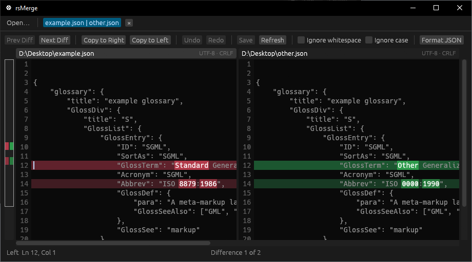

# rsMerge



A fast, WinMerge-style compare tool for files, folders and images, written in Rust
([egui](https://github.com/emilk/egui)). Runs on Windows, macOS and Linux.

- **Open screen:** pick two files or folders (browse, type, recent list, or drag and drop).
  Open screens are tabs, so several comparisons can be set up at once (**+** adds one);
  dropping files onto a comparison in progress starts a new Open tab instead of replacing it.
  Dropping single files alternates between the left and right path.
- **File compare:** editable side-by-side view with synced scrolling, aligned filler lines,
  word-level highlights, an overview strip, copy difference left/right, undo/redo and save
  (keeps each file's encoding, BOM and line endings). JSON files get a **Format JSON** button
  (sorted keys, 4-space indent) that's a single undo step. JSON objects and arrays can be
  folded; other text folds by indentation, but only where both sides are identical.
  Tab / Shift+Tab indent and outdent the selected lines (detecting tabs or spaces from nearby
  lines), and **Sort Lines**, **Sort Numeric** (F9) and **Unique Lines** (F10) work on the
  selection, or the whole side with no selection.
- **Image compare:** side by side or as a blended overlay with shared zoom and pan, changed
  pixels highlighted, step through changed regions, adjustable colour tolerance.
- **Folder compare:** tree or flat list with Show toggles (Identical / Different / Left only /
  Right only, any combination), compare by contents or size & date, exclude patterns
  (`.git, node_modules, *.tmp`). Double-click (or Enter) a file to open it side by side; a file
  that exists on one side only opens against an empty side, and saving creates it.

`rsmerge LEFT RIGHT` opens two files or two folders directly.

## Keys

| Action | Windows / Linux | macOS |
|---|---|---|
| Next / previous difference | Alt+Down / Alt+Up | Option+Down / Option+Up |
| Copy difference to right / left | Alt+Right / Alt+Left | Cmd+Option+Right / Left |
| Undo / redo | Ctrl+Z / Ctrl+Y | Cmd+Z / Cmd+Shift+Z |
| Indent / outdent selected lines one level | Tab / Shift+Tab | Tab / Shift+Tab |
| Sort lines numerically (selection, or whole side) | F9 | F9 |
| Remove duplicate lines (selection, or whole side) | F10 | F10 |
| Save changed sides | Ctrl+S | Cmd+S |
| Refresh (reload files / rescan folders) | F5 | F5 |
| Close tab | Ctrl+W | Cmd+W |
| Folder list: move / open / collapse / expand | Up, Down / Enter / Left / Right | same |

Right-click a difference for Copy to Right / Copy to Left. Click in a grey filler gap and
type to add lines there (e.g. a comment explaining why something is missing).

## Build

Requires Rust (https://rustup.rs). Build on each OS natively:

```sh
cargo run --release
```

- **macOS / Windows:** no extra dependencies.
- **Linux:** needs an X11 or Wayland desktop with OpenGL. The Browse buttons use the
  XDG desktop portal (standard on GNOME/KDE), falling back to `zenity` if no portal is running.

Cross-building a Windows `.exe` from Linux (needs `mingw-w64`):

```sh
rustup target add x86_64-pc-windows-gnu
cargo build --release --target x86_64-pc-windows-gnu
```

## Code

- `src/main.rs` — app shell: tabs, unsaved-changes prompts. `App::open_file_compare` is the
  one entry point into the file view.
- `src/open_dialog.rs` — the Open screen (one per Open tab).
- `src/folder_view.rs` — the folder comparison view; `src/folder_scan.rs` — scanning and comparing.
- `src/compare.rs` — the side-by-side editor view.
- `src/diff.rs` — line diff model (aligned rows, difference blocks, word-level changes).
- `src/text_file.rs` — loading/saving with encoding and line-ending detection.
- `src/json_format.rs` — canonical JSON formatting for the Format JSON button, plus JSON and indentation folds.
- `src/image_compare.rs` — the image view; `src/image_diff.rs` — pixel diff and changed regions.
